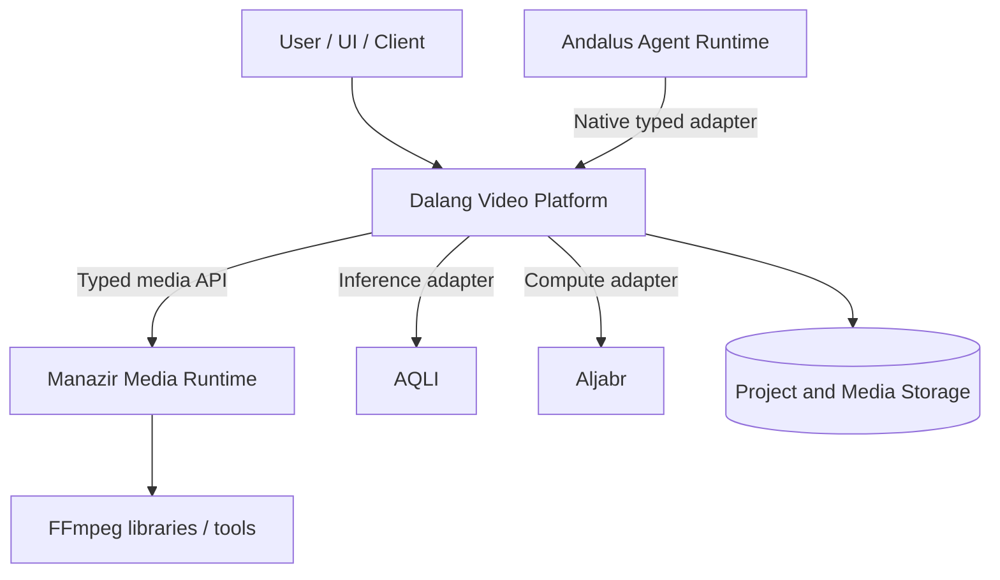
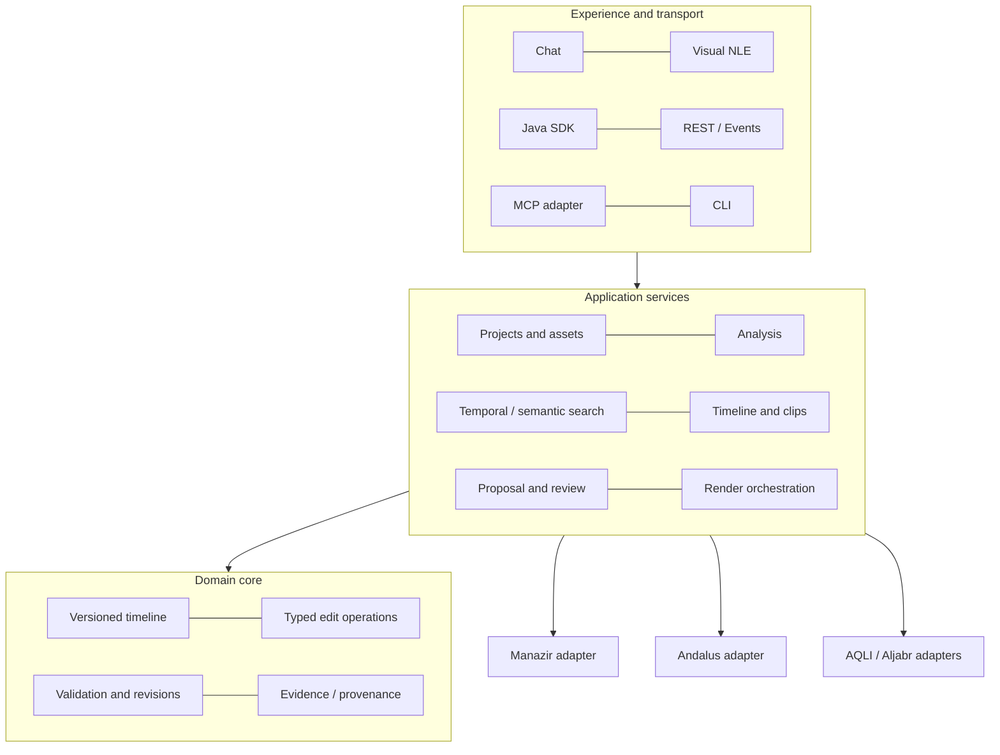
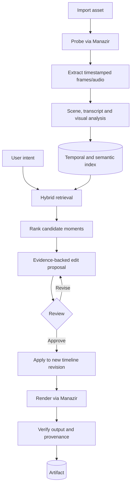
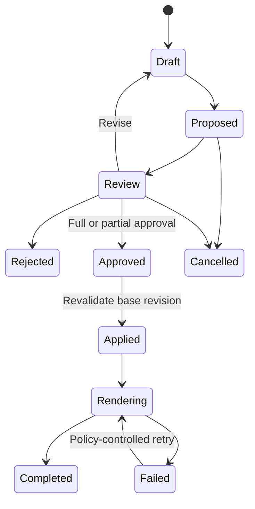
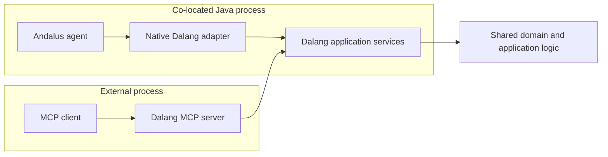

# Dalang architecture diagrams

These describe intended boundaries; concrete adapters must follow verified public APIs.

## Ecosystem context

## Dalang layers

## Analysis-to-render workflow

## Proposal lifecycle

## Native versus MCP

Native calls typed services directly. MCP is an external protocol adapter, never a mandatory internal hop.