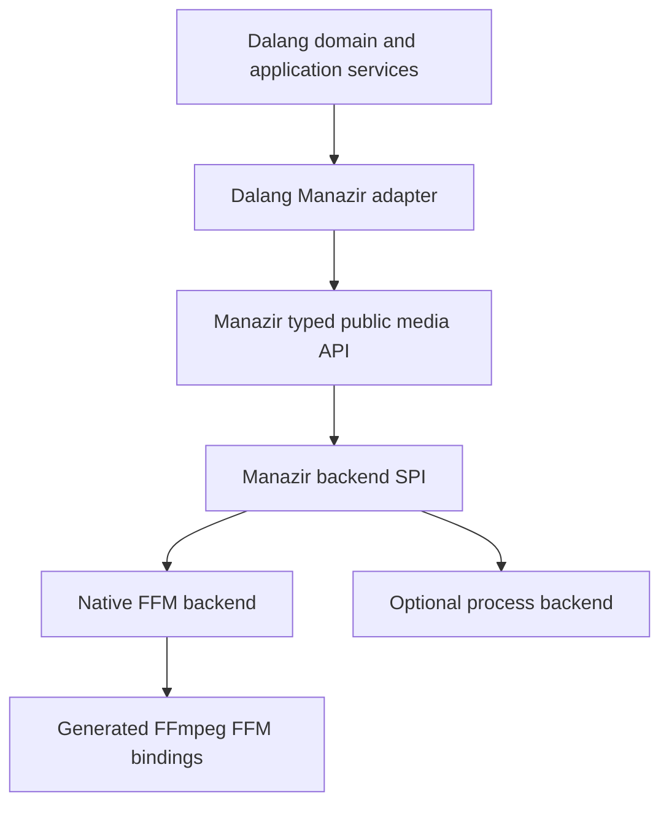

# Manazir integration contract

## Ownership
Dalang owns video-product concepts: workspaces, projects, immutable assets, observations, temporal indexes, proposals, timelines, clipper workflows and render intent. Manazir owns media execution: probing, stream metadata, timestamp-preserving extraction, transcoding, filtering, muxing, native diagnostics and backend capability reporting. Manazir must not depend on Dalang.

## Dependency direction

Dalang must not import generated binding packages or expose MemorySegment, pointers, FFmpeg structs or backend enums publicly.

## Required capabilities
1. Probe container and stream metadata with exact timing.
2. Decode/extract timestamped frames, thumbnails, audio segments and waveforms.
3. Typed transforms: trim, scale, crop, resample and transcode.
4. Compose/render via typed plans and muxing.
5. Runtime diagnostics, capability reporting, progress, cancellation, limits and structured errors.
First vertical slice: probe plus timestamp-preserving extraction. Dalang capability-checks optional operations.

## Time contract
Manazir provides low-level integer timestamp/rational timebase primitives. Dalang owns timeline coordinates. Source timestamps and timeline positions are distinct. Conversion specifies rounding. Preserve stream timebase, start timestamp, duration ticks and decoded frame PTS where available.

## Safety and lifecycle
Use typed options, not arbitrary shell strings. Process backends use argument vectors and safe filter representations. Bound duration, memory, temp storage, output size and concurrency. Long operations expose progress/cancellation. Native handles and FFM segments never cross public API. Source assets remain read-only; derived artifacts have explicit destinations/provenance. Native library load success is not proof of ABI/symbol compatibility.

## Compatibility
Dalang compiles against a released Manazir API. Until then isolate adapter and avoid generated binding coupling. Contract tests cover metadata mapping, timebase preservation, cancellation and diagnostics.